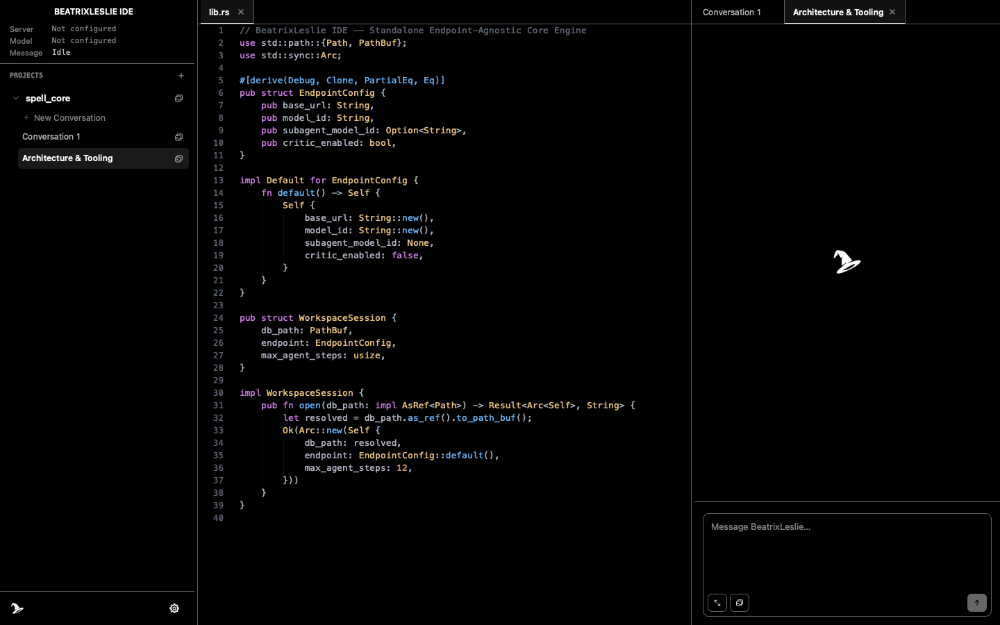

# BeatrixLeslie IDE - Product Documentation



## Overview

BeatrixLeslie IDE implements the OpenAI wire protocol exclusively. Connect it to any `/v1` endpoint - local or remote - and it functions seamlessly. API keys reside in the OS keychain. Your code never leaves your machine unless you explicitly transmit it.

## Architecture

Three Panes:

1. Projects & Conversations - Organize work and dialogue history
2. Editor - Code editing and review
3. Agent - Autonomous assistance

Two Modes:

- Ask - Read-only inspection and analysis
- Write - Edit, run, and verify changes

## Workflow

Stage-Write Protocol:

- Every change produces a diff
- Changes require explicit approval before landing
- No unapproved modifications reach the working tree

Gatekeeper Critic:

- A second-pass review rejects defective edits
- Bad changes are blocked before user visibility

Subagents:

- Bounded parallel coding tasks
- Work is either committed or escalated for review

Timers:

- Local, persistent, SQLite-backed scheduling
- Supports asynchronous job monitoring

## Message Terminal Integration

The IDE hands the terminal directly to the agent. When failures occur:

```text
why did this fail?
```

The working directory and recent output are attached contextually. The agent resumes from that state - no copy, no paste, no context loss.

## Installation

### Downloads

Prebuilt archives with SHA256 verification are published on [GitHub Releases](https://github.com/spell-ide/BeatrixLeslie/releases):

| Platform | Artifact |
| :-- | :-- |
| macOS 14+ (Apple Silicon) | `BeatrixLeslieIDE-macos-arm64.zip` |
| macOS 14+ (Intel) | `BeatrixLeslieIDE-macos-x86_64.zip` |
| Linux x86_64 (AppImage) | `BeatrixLeslieIDE-linux-x86_64.AppImage` |
| Linux x86_64 (Portable) | `BeatrixLeslieIDE-linux-x86_64.tar.gz` |
| Windows 10/11 x86_64 | `BeatrixLeslieIDE-windows-x86_64.zip` |

Verification:

```bash
shasum -a 256 -c SHA256SUMS.txt --ignore-missing
```

### Platform-Specific Installation

| Platform | Instructions |
| :-- | :-- |
| macOS | Signed and notarized. Unzip > Drag to Applications > Open |
| Linux | `chmod +x BeatrixLeslieIDE-linux-x86_64.AppImage && ./BeatrixLeslieIDE-linux-x86_64.AppImage` |
| Windows | Unsigned. SmartScreen > More info > Run anyway |

## Requirements

| Platform | Toolchain |
| :-- | :-- |
| macOS 14+ | Xcode CLT, Rust, `brew install cmake ninja qtbase qtsvg qscintilla2` |
| Ubuntu / Debian | `build-essential cmake ninja-build pkg-config patchelf file qt6-base-dev qt6-base-dev-tools qt6-svg-dev qt6-wayland libqscintilla2-qt6-dev libdbus-1-dev libsecret-1-dev libgl1-mesa-dev libxkbcommon-dev libxcb-cursor0`, Rust |
| Fedora | `gcc-c++ cmake ninja-build pkgconf-pkg-config patchelf file qt6-qtbase-devel qt6-qtsvg-devel qt6-qtwayland-devel qscintilla-qt6-devel dbus-devel libsecret-devel`, Rust |
| Arch | `base-devel cmake ninja pkgconf patchelf file qt6-base qt6-svg qt6-wayland qscintilla-qt6 dbus libsecret`, Rust |
| Windows 10/11 | Visual Studio 2022 (C++), Rust (MSVC), Qt 6.7+ (`msvc2019_64` / `msvc2022_64` on `PATH`), `.\scripts\install_qscintilla_windows.ps1` |

Rust: [https://rustup.rs](https://rustup.rs)

## Build Process

### Standard Build

```bash
git clone https://github.com/spell-ide/BeatrixLeslie.git
cd BeatrixLeslie
./scripts/build_and_run.sh --test --verify-loader --run
```

### macOS Self-Contained .app

```bash
./scripts/build_and_run.sh --install dist --deploy-qt --test --verify-loader
```

Signing & Notarization:

```bash
./scripts/build_and_run.sh --install dist --deploy-qt \
  --codesign-identity "Developer ID Application: <Name> (<TEAMID>)" \
  --notary-key AuthKey_<KEYID>.p8 --notary-key-id <KEYID> --notary-issuer <ISSUER-UUID>
```

### Linux Self-Contained Bundle & AppImage

```bash
./scripts/build_and_run.sh --install dist --deploy-qt --test --verify-loader \
  --package-appimage BeatrixLeslieIDE-linux-x86_64.AppImage
```

### Windows (Visual Studio 2022 Developer PowerShell)

```powershell
.\scripts\install_qscintilla_windows.ps1
.\scripts\build_and_run.ps1 -InstallPrefix dist -DeployQt -Test -VerifyLoader -Run
```

### Manual Build

```bash
cmake -S . -B build -DCMAKE_BUILD_TYPE=Release
cmake --build build --parallel 4
ctest --test-dir build --output-on-failure
cmake --install build --prefix dist
```

The Rust core builds automatically.

## Setup

1. Open Settings > Engine
2. Enter a base URL
3. Fetch available models
4. Select a model
5. Save configuration

### Supported Endpoints

| Endpoint | Base URL |
| :-- | :-- |
| Ollama | `http://127.0.0.1:11434/v1` |
| LM Studio | `http://127.0.0.1:1234/v1` |
| llama.cpp / vLLM | `http://127.0.0.1:8080/v1` |
| OpenAI | `https://api.openai.com/v1` |
| OpenRouter | `https://openrouter.ai/api/v1` |

Security: API keys stored in OS keychain. No plaintext disk storage. No network requests until an endpoint is explicitly saved.

## Contributing & Security

Refer to [CONTRIBUTING.md](CONTRIBUTING.md) and [SECURITY.md](SECURITY.md) for guidelines.

## License

- Application: GPL-3.0-only (see [LICENSE](LICENSE))
- Rust Core ([rust/spell_core](rust/spell_core)): MIT OR Apache-2.0
- Third-Party Dependencies: [THIRD_PARTY_NOTICES.md](THIRD_PARTY_NOTICES.md)
